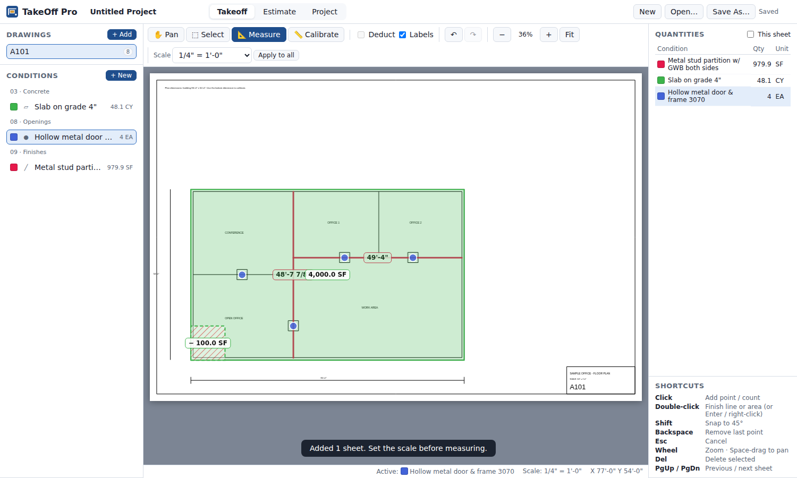
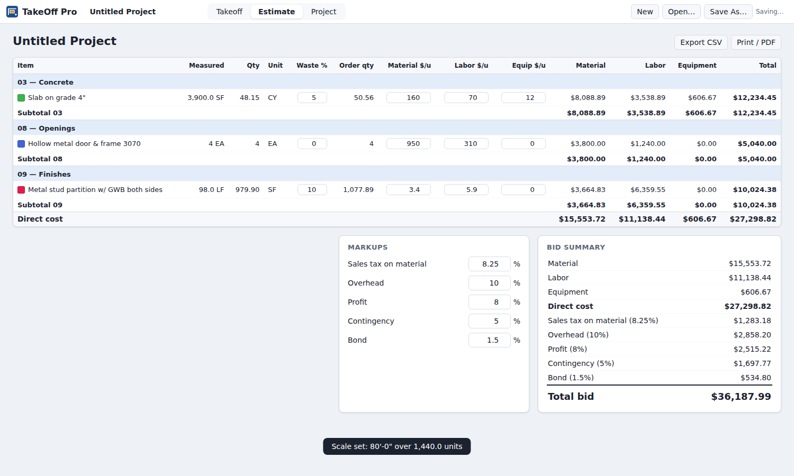

# TakeOff Pro

Browser-based **quantity takeoff and estimating** for construction contract drawings.
Load PDF (or scanned image) plan sets, set the drawing scale, measure lengths, areas and
counts directly on the sheets, and turn those quantities into a priced estimate organized
by CSI MasterFormat division — with waste, markups, CSV export and a printable bid summary.



## Quick start

```bash
npm install     # installs PDF.js (the only dependency)
npm start       # http://localhost:5173
```

Then open <http://localhost:5173>, click **+ Add** under *Drawings* and choose a PDF.
A sample plan is included at `samples/sample-floor-plan.pdf` (80'×50' office at 1/4" = 1'-0").

Requires Node 18+ and a modern browser (Chrome, Edge, Firefox, Safari). Everything runs locally —
drawings never leave your machine.

## Workflow

1. **Add drawings** – PDF, PNG, JPG or WebP (button or drag & drop). Each PDF page becomes a sheet;
   sheet numbers such as `A101` are detected from the title block when possible. Rename with ✎.
2. **Set the scale** for each sheet:
   - pick a preset (architectural, engineering or metric) from the toolbar — presets assume the PDF
     is at its true paper size; for images, enter the scan **DPI**; or
   - **Calibrate** (`K`): click both ends of a known dimension and type its length
     (`20'`, `12'-6 1/2"`, `150"`, `3.5m`, `300mm` …).
   - **Apply to all** copies the scale to every sheet.
3. **Create conditions** – the items you measure. Start from the built-in assembly library or a blank
   condition, and choose:

   | Measure as | Priced per | Extra inputs |
   |---|---|---|
   | Linear (polyline) | LF, SF, CY | SF: height (ft) · CY: width × depth (in) |
   | Area (polygon) | SF, SY, SQ, CY | CY: thickness (in) |
   | Count (points) | EA | — |

   plus CSI division, colour, waste %, and material / labor / equipment unit costs.
4. **Measure** – select a condition (the Measure tool activates), then click on the drawing:
   - Linear/area: click points; **double-click**, **Enter** or **right-click** to finish; click the
     start point to close an area. **Shift** snaps to 45°; **Backspace** removes the last point.
   - Tick **Deduct** (`D`) to draw openings/voids that subtract from an area.
   - Count: every click is one item.
5. **Review & edit** – the Select tool (`S`) lets you pick a measurement, drag its vertices, move it to
   another condition, toggle deduction, or delete it. Full undo/redo (`Ctrl+Z` / `Ctrl+Y`).
6. **Estimate** tab – quantities roll up by division with waste, extended material/labor/equipment
   costs and subtotals. Unit costs and waste are editable in place. Markups are applied in order:
   sales tax (on material) → overhead → profit → contingency → bond.
   Export to **CSV** (opens in Excel) or **Print / PDF** a clean bid sheet.



### Saving

Projects auto-save in the browser (IndexedDB), drawings included, and reopen where you left off.
The *Project* tab lists all projects stored in this browser. **Save As…** (`Ctrl+S`) writes a portable
`.takeoff.json` with drawings embedded; **Open…** (or dropping the file on the window) loads one.

### Keyboard shortcuts

| Key | Action | Key | Action |
|---|---|---|---|
| `V` / `H` | Pan tool | `F` | Fit sheet |
| `S` | Select tool | `+` / `-` / wheel | Zoom |
| `M` | Measure tool | Space-drag / middle-drag | Pan |
| `K` | Calibrate | `PgUp` / `PgDn` | Previous / next sheet |
| `D` | Toggle deduct | `Del` | Delete selected |
| `Esc` | Cancel / deselect | `Ctrl+Z` / `Ctrl+Y` | Undo / redo |

## Cost data

The assembly library (`public/js/core/catalog.js`) ships with **illustrative placeholder prices** so
the app is usable out of the box. They are not a cost database — replace them with your own labor
rates, supplier quotes or a commercial cost source before bidding.

## Project layout

```
server.js                 zero-dependency static server (serves public/ and PDF.js from node_modules)
public/
  index.html, styles.css
  js/app.js               UI controller, state, undo/redo, persistence wiring
  js/viewer.js            PDF/image rendering, zoom/pan, SVG overlay, drawing & editing tools
  js/store.js             IndexedDB storage for projects and drawing files
  js/core/                framework-free logic (also used by the tests)
    geometry.js           lengths, shoelace area, hit-testing, angle snapping
    scale.js              scale presets, calibration, feet-inch parsing/formatting
    quantities.js         measurement → LF/SF/EA → priced unit (SF, SY, SQ, CY …)
    estimate.js           pricing, division roll-ups, markups, CSV
    catalog.js            CSI divisions, units, starter assemblies
    model.js              project/sheet/condition/measurement factories
scripts/make-sample-pdf.js  regenerates samples/sample-floor-plan.pdf (`npm run sample`)
test/                     unit tests (`npm test`)
```

## Tests

```bash
npm test
```

Covers geometry, scale math, length parsing, unit conversions, quantity roll-ups (including
deductions and unscaled sheets), markup sequencing and CSV output.

## Limitations / ideas

- Quantities are imperial internally (metric lengths are accepted for calibration and metric scales
  are supported, but output units are LF/SF/SY/CY).
- No curved segments (arcs are approximated with extra points), no sheet overlay/compare, and no
  multi-user sync — these are natural next steps.
